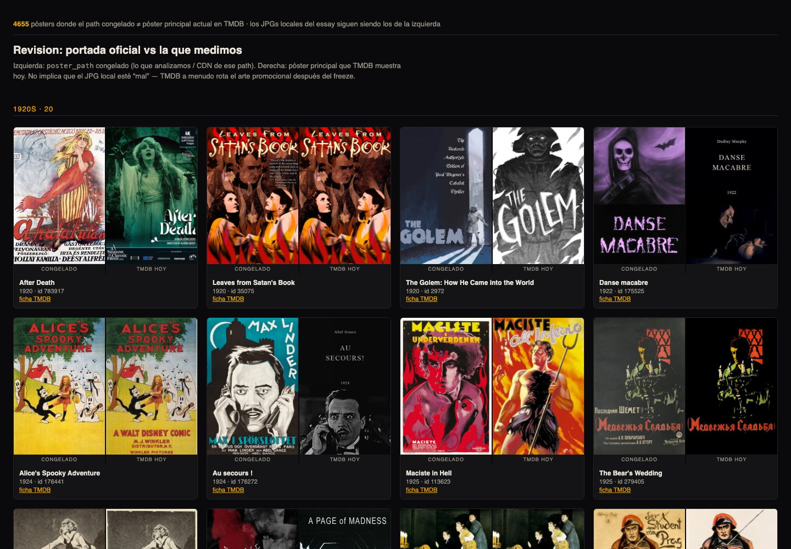
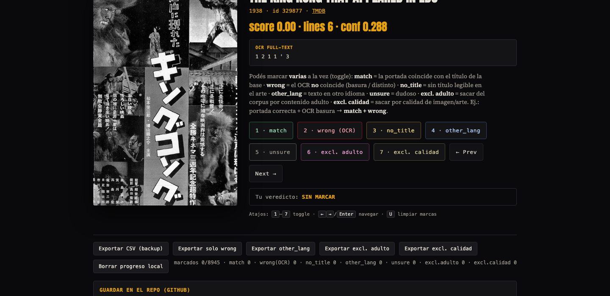
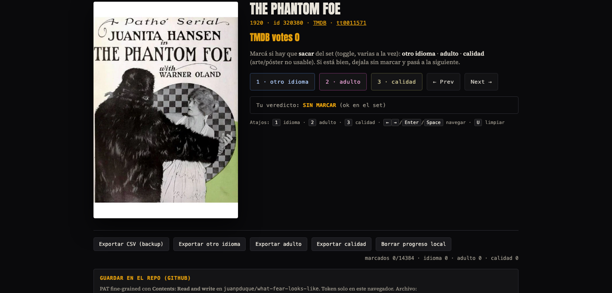
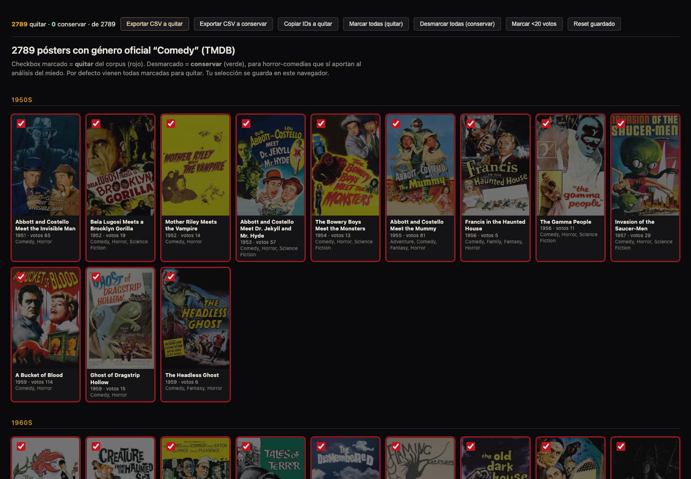
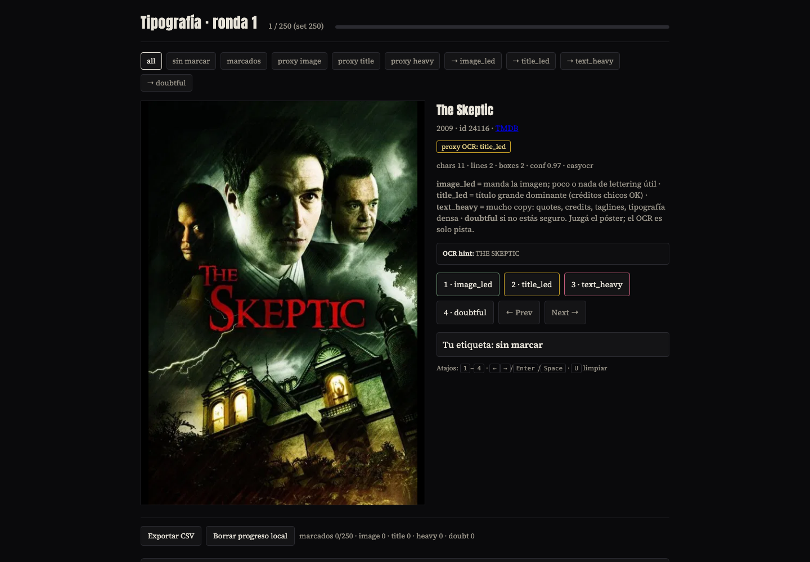
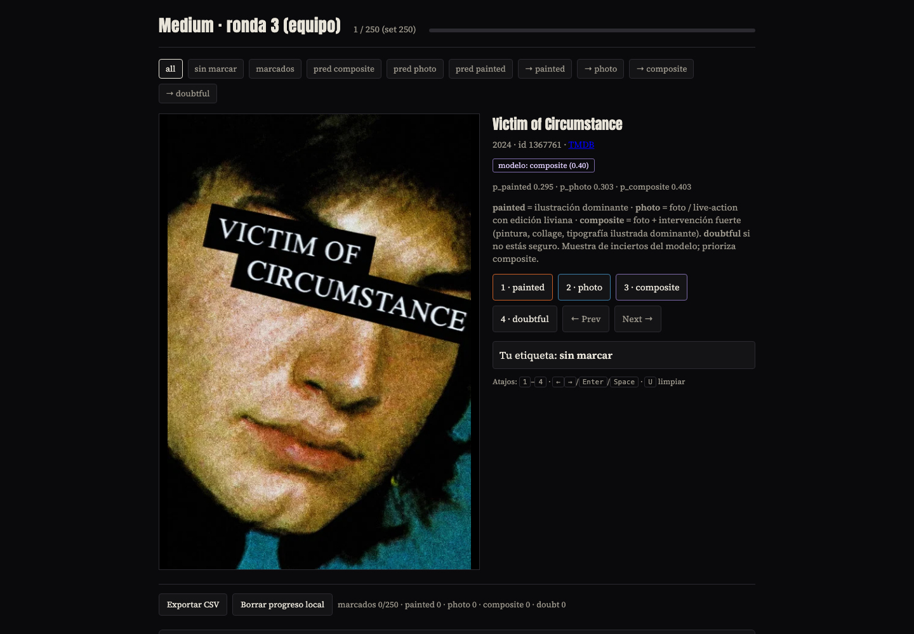
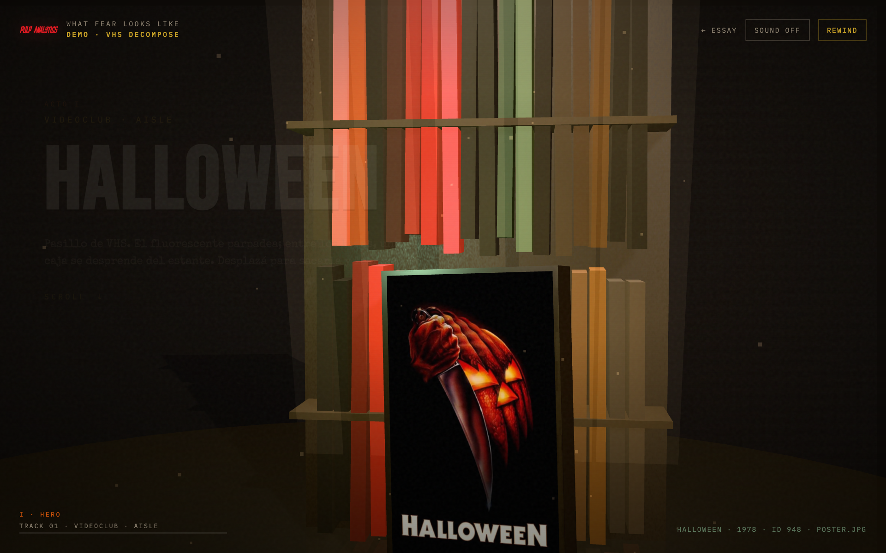
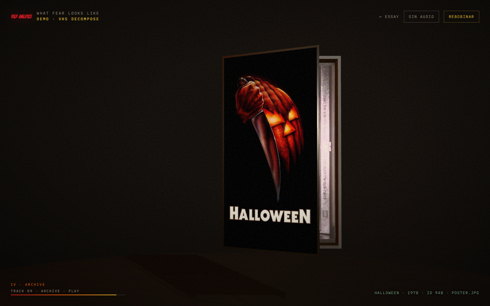
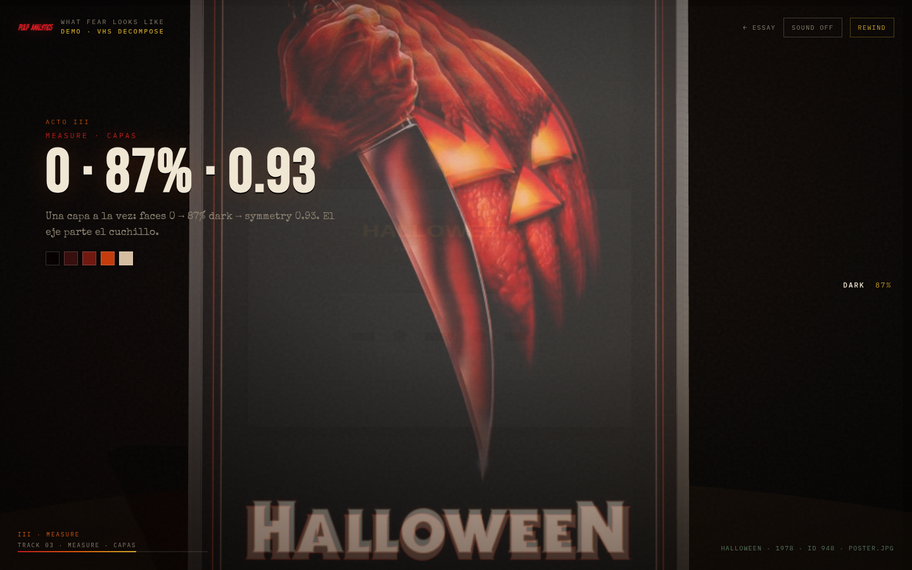
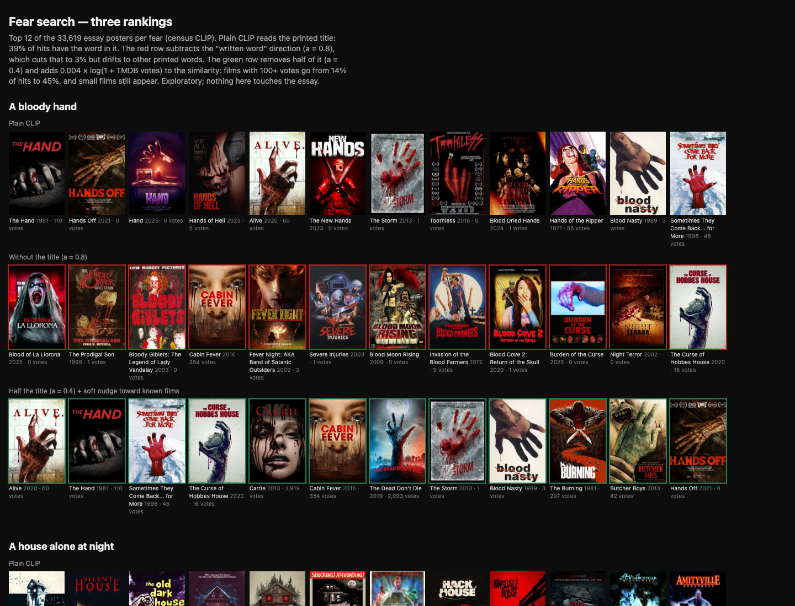

# What Fear Looks Like — how it was made

Process notes for [**What Fear Looks Like**](https://pulpanalytics.com/), a visual
essay on 33,619 horror movie posters from 1900 to 2026. This repo holds no code:
it is the story of how the essay came together, with screenshots of the tools
built along the way.

The code is open in three repos:
[corpus validation](https://github.com/pulp-analytics/poster-corpus-validation) ·
[per-poster metrics](https://github.com/pulp-analytics/poster-metrics-pipeline) ·
[cloud setup](https://github.com/pulp-analytics/poster-analysis-infrastructure).

## The question

Horror has been my favorite film genre since I was a kid. To bring that passion
together with my other one, analyzing data, I started from a question: what can
horror posters tell us? The question grew. In the VHS era, the box art was what
made us rent a movie or pass on it. The scene has changed since then, but the
cover is still the first thing that catches a viewer.

## July 2026 — a first prototype, and a corpus to clean

The project started on July 12 with a pipeline and a scrollytelling prototype.
The hard part came next: deciding which posters belong in the corpus. TMDB is
generous with the "Horror" tag, and the primary poster it shows today is not
always the one I had measured. I built small review pages and went through the
doubtful cases by hand.

**Poster drift.** 4,655 films whose primary poster on TMDB had changed since I
measured it, side by side: the sheet I measured on the left, today's on the
right.

**Does the poster match the film?** 8,945 sheets where OCR of the printed title
was checked against the catalog title, to catch posters that belong to another
film, sheets in another language, and art with no legible title.

**What stays in.** 14,384 sheets reviewed for language, adult content and art
quality; and 2,789 films tagged both Horror and Comedy, kept or dropped one by
one.

## August 2026 — checking the models against my own labels

Before trusting a model's reading of thousands of posters, I labeled samples
myself: rounds of 250 posters for lettering (image-led, title-led, text-heavy)
and for medium (painted, photo, composite), then compared the model's calls with
mine.

## Late August 2026 — the 3D video store

The first idea for the experience was literal: walk down a VHS aisle, pull the
*Halloween* box off the shelf, open it, and watch the measurements peel off the
cover one layer at a time.

I shipped it as a demo in September and removed it in November. The result
wasn't what I had hoped for, and I didn't want to tell the story of one cover
but of more than 30,000; one box at a time got heavy. A hybrid version didn't
work for me either. What survived is the idea of dissecting one poster layer by layer: it became
the essay's "light table" autopsy, which works for any of the 33,619 sheets.

## September–October 2026 — the essay

The essay went live in late September and kept changing: per-poster autopsies
with alternate sheets, a page on the studios that design horror posters, browser
smoke tests, and 95% intervals on every decade series. In October I also took
out three claims that the published data did not support.

Two rules held the whole time: one model owns each published number (the others
are QA notes), and every measurement is tied to the hash of the exact image
measured.

## November 2026 — "Or pick a fear"

The last feature lets a reader pick a fear (a bloody hand, a doll, an empty
corridor…) and see the twelve posters that look most like it. Plain CLIP turned
out to read printed titles: 39% of its hits had the fear's word in the title. I
compared three rankings side by side and chose the one that removes half of
that bias and gives well-known films a slight push.

## Tools

Python for the pipeline: k-means in CIELAB for color, YuNet for faces, a CLIP
census for creatures (open_clip), OpenCV for text coverage and composition
(symmetry, diagonals, the rule of thirds), MSI-Net for the saliency heat map and
ViTPose for the pose skeleton in each poster's autopsy. AWS Step Functions and
Batch for the heavy runs, a static Vite site on Netlify, and
Supabase for each poster's autopsy data. I used Claude as a coding and editing
assistant throughout; the question, the method decisions, the manual reviews
and the readings in the essay are mine.

Posters are shown here as examples of the review work. Film data and images from
[TMDB](https://www.themoviedb.org/); this project is not endorsed or certified
by TMDB.
